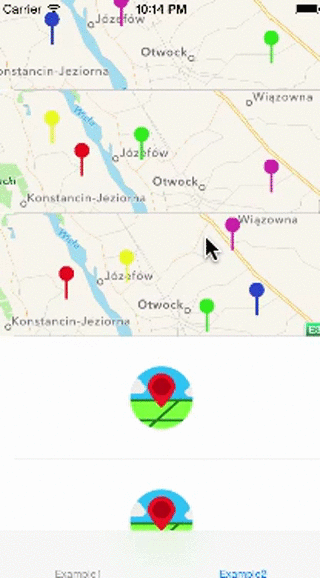
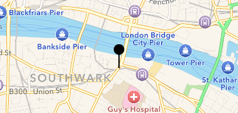
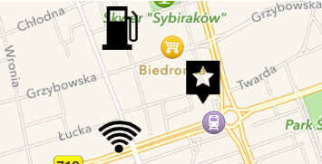
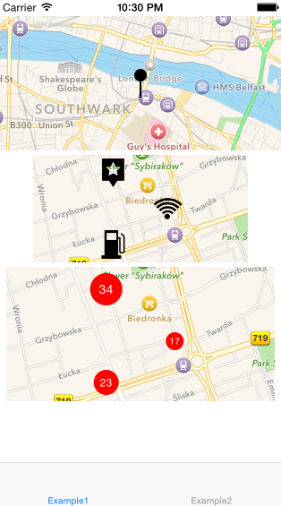

# BGMapPreview

**An iOS library for generating asynchronous map preview images with custom annotations using MapKit.**

BGMapPreview turns one or more geographic locations into a map image that can be displayed directly in a `UIImageView`. It provides a lightweight API for creating map previews without requiring each consuming application to implement snapshot generation, annotation positioning, caching, and operation management independently.

Originally developed in Objective-C, the library exposes an API usable from both Swift and Objective-C.

## Demo

BGMapPreview generates map previews from geographic coordinates and supports custom annotation views.

### Animated example



### Map preview examples





Additional example:



## Features

- **Single and multiple locations** — generate a preview centered and scaled to include the supplied coordinates.
- **Custom annotations** — use custom `UIView` instances for map pins and configure their horizontal and vertical anchor points.
- **Asynchronous generation** — create map snapshots without requiring the caller to manage the snapshot workflow.
- **Operation cancellation** — cancel the previous preview operation associated with an image view when a new preview is requested.
- **Image caching** — reuse previously generated previews through a shared `NSCache`-based cache.
- **Placeholder images** — display a placeholder while a preview is being generated.
- **Auto Layout support** — explicitly provide the target image size when the view's final layout dimensions are not yet available.
- **Swift and Objective-C compatibility** — integrate the library into existing iOS projects using either language.

## Example

The following example generates a map preview for a single location and displays a custom pin.

```swift
import UIKit
import CoreLocation
import BGMapPreview

let locationDescriptor = BGLocationDescriptor()
locationDescriptor.location = CLLocation(
    latitude: 51.5057879,
    longitude: -0.0887631
)

let pinView = UIImageView(
    frame: CGRect(x: 0, y: 0, width: 32, height: 32)
)
pinView.image = UIImage(named: "pin1")

locationDescriptor.annotationView = pinView

let mapImageView = UIImageView(
    frame: CGRect(x: 0, y: 0, width: 320, height: 200)
)

mapImageView.setPreviewWith(locationDescriptor)
```

The generated preview is assigned to `mapImageView` when the snapshot and annotation composition are complete.

## Multiple Locations

Pass an array of location descriptors to generate a single preview containing multiple locations. The map region is calculated to accommodate the supplied points.

```swift
let descriptors: [BGLocationDescriptor] = [
    firstLocationDescriptor,
    secondLocationDescriptor,
    thirdLocationDescriptor
]

mapImageView.setPreviewWithLocationDescriptors(descriptors)
```

Each descriptor can provide its own location, annotation view, and anchor configuration.

## Placeholder and Explicit Image Size

A placeholder can be displayed while the map preview is being generated.

```swift
mapImageView.setPreviewWithLocationDescriptors(
    descriptors,
    placeholder: UIImage(named: "map-placeholder")
)
```

If the view uses Auto Layout and its final dimensions are not available when generation starts, provide the intended image size explicitly:

```swift
mapImageView.setPreviewWithLocationDescriptors(
    descriptors,
    placeholder: UIImage(named: "map-placeholder"),
    imageSize: CGSize(width: 320, height: 200)
)
```

Providing a non-zero image size is required. The default convenience methods use the image view's current frame size.

## Custom Annotation Anchors

`BGLocationDescriptor` supports configurable horizontal and vertical anchor points:

- Horizontal: left, center, or right.
- Vertical: top, center, or bottom.

These settings control how a custom annotation view is positioned relative to its geographic coordinate. By default, annotations are horizontally centered and vertically anchored at the bottom, which is suitable for conventional map pins.

## How It Works

The implementation separates the public `UIImageView` API from the map generation and caching components.

1. **Describe locations** using `BGLocationDescriptor`, including coordinates and custom annotation views.
2. **Configure the map** using MapKit, calculating a region that accommodates the supplied annotations.
3. **Generate a snapshot** using `MKMapSnapshotter`.
4. **Compose the final image** by positioning the custom annotation views over the map snapshot.
5. **Cache and display the result** through the image view's completion workflow.

The library also associates preview operations with their target image views so that a subsequent request can cancel previously scheduled work.

## Installation

BGMapPreview is distributed through CocoaPods.

Add the following dependency to your `Podfile`:

```ruby
pod 'BGMapPreview'
```

Then install the dependency:

```bash
pod install
```

Import the library into Swift:

```swift
import BGMapPreview
```

Or into Objective-C:

```objective-c
#import <BGMapPreview/UIImageView+BGMapPreview.h>
```

## Requirements

- **Xcode 27.2** — the project has recently been refreshed and verified to open and run in this environment.
- The published CocoaPods specification declares an iOS deployment target of iOS 8.0.
- UIKit and MapKit.

The iOS 8.0 deployment target reflects the library's original compatibility baseline. The project has been updated to remain runnable in a modern Xcode environment.

## Project Background

BGMapPreview is an example of a reusable iOS component designed to encapsulate a non-trivial UI workflow behind a concise public API.

Although originally developed as a legacy Objective-C library, the project has recently been refreshed to ensure it remains runnable with Xcode 27.2.

The implementation explores:

- MapKit snapshot generation and image composition.
- Asynchronous work using `NSOperation`.
- Cancellation of previously requested operations.
- Shared in-memory caching using `NSCache`.
- Custom annotation positioning and map-region calculation.
- API design for Swift and Objective-C consumers.
- CocoaPods-based library distribution.

## License

BGMapPreview is distributed under the MIT License. See [LICENSE](LICENSE) for details.

## Authors

- Bartlomiej Guminiak
- Konrad Szczęśniak

Repository: [github.com/bartguminiak/BGMapPreview](https://github.com/bartguminiak/BGMapPreview)